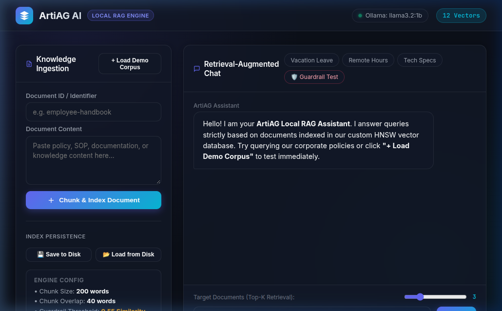
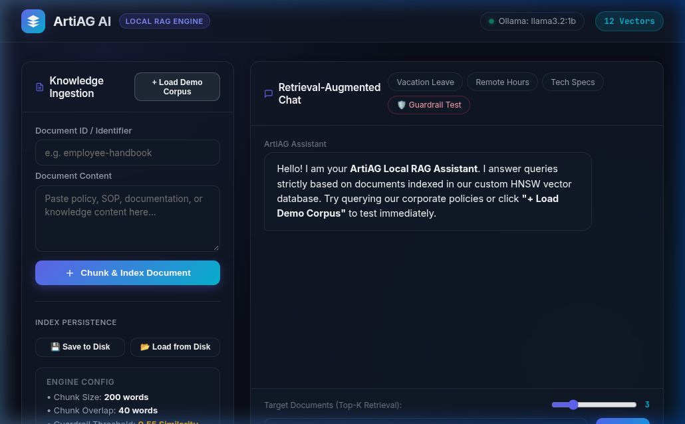
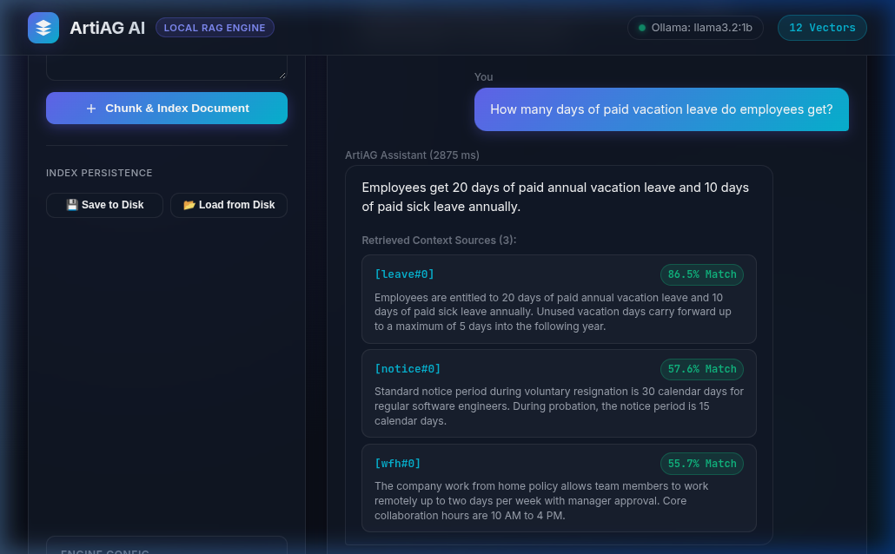
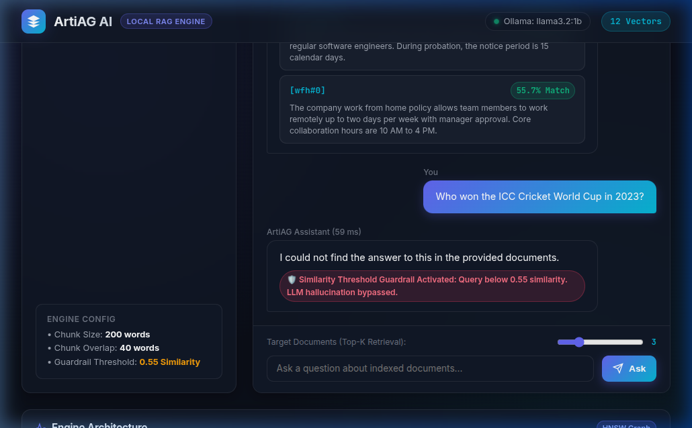

# ArtiAG AI — Lightweight Local RAG Engine

A privacy-first, 100% offline Retrieval-Augmented Generation (RAG) engine built with **Java 21**, **Spring Boot 3**, and a **custom embedded HNSW vector database** paired with local **Ollama** models (`llama3.2:1b` + `nomic-embed-text`).

---

## 📂 Project Structure

```
ArtiAG AI- LightWeight Local RAG Engine/
├── 🌐 frontend/           # Complete Web Interface
│   └── index.html         # Glassmorphic UI Dashboard (HTML + CSS + JS)
├── ⚙️ backend/            # Complete Spring Boot 3 Engine & HNSW Vector DB
│   ├── pom.xml            # Maven build configuration
│   ├── src/               # Java 21 controllers, services, HNSW index & resources
│   ├── eval/              # Benchmarks & live evaluation scripts
│   └── data/              # Snapshot persistence storage (index.json)
├── 🖼️ assets/             # Test screenshots & visual demonstration
└── 📄 README.md           # Single project documentation & instructions
```

---

## 1. What is it?

**ArtiAG AI** is an ultra-lightweight, private, and fully offline RAG engine:
- **No External Vector Database**: Eliminates the need for external database infrastructure like Pinecone, Milvus, or Chroma. It implements its own custom **Hierarchical Navigable Small World (HNSW)** vector graph running directly in JVM heap memory.
- **100% Offline AI**: Runs entirely on your local machine using **Ollama** for embeddings (`nomic-embed-text`) and response generation (`llama3.2:1b`), with zero cloud dependencies or API subscription bills.
- **Hallucination Guardrail**: Automatically evaluates cosine similarity scores. If a query relevance score drops below **`< 0.55`** (out-of-scope question), the engine halts in **`< 80 ms`** without invoking the LLM, eliminating hallucinations and saving compute.
- **Built-in Web Dashboard**: Includes a modern, glassmorphic web interface served directly by Spring Boot at `http://localhost:8080/`.

---

## 📸 Visual Walkthrough & Test Screenshots

Here are live screenshots captured during end-to-end testing of ArtiAG AI:

### 1. Web Dashboard & System Overview
Dark-mode glassmorphic dashboard tracking Ollama model status (`llama3.2:1b` & `nomic-embed-text`) and JVM vector memory.



---

### 2. Document Chunking & Corpus Ingestion
Ingesting documents with sliding-window chunking (200-word windows, 40-word overlap) and indexing them directly into the JVM heap HNSW graph.



---

### 3. Live RAG Query & Source Attribution
Semantic search retrieves top-$k$ relevant passages with exact cosine similarity scores and generates grounded, factual answers.



---

### 4. Hallucination Guardrail in Action (< 80 ms)
For out-of-scope queries (similarity score $< 0.55$), the engine halts instantly without invoking the LLM, maintaining out-of-scope refusal and saving compute.



---

## 2. Architecture & Flow

```
[ 1. Web Browser UI ] (http://localhost:8080/)
       │  REST API (JSON)
       ▼
[ 2. Spring Boot Engine ] (Port 8080)
   ├── VectorRagController.java  --> REST endpoints (/ingest, /chat/query, /status)
   ├── RagService.java           --> Central orchestrator & similarity guardrail (0.55)
   ├── TextChunker.java          --> 200-word sliding windows, 40-word overlap
   ├── HNSWIndex.java            --> In-memory vector graph (M=16, efC=128, efS=100)
   ├── CosineDistance.java       --> Cosine similarity vector mathematics
   └── IndexPersistenceService   --> Saves/loads disk snapshots (data/index.json)
       │  HTTP Client
       ▼
[ 3. Local Ollama Server ] (Port 11434)
   ├── nomic-embed-text          --> 768-dimensional vector embeddings (274 MB)
   └── llama3.2:1b               --> Local generation LLM (1.3 GB)
```

### Core Data Pipeline:
1. **Ingest Pipeline**: Document Text &rarr; 200-word sliding chunks &rarr; `nomic-embed-text` generates 768-dim float vector &rarr; Inserted into multi-layer HNSW graph.
2. **Query Pipeline**: User question &rarr; Query vector generated &rarr; HNSW graph retrieves top-3 matching chunks by cosine similarity.
3. **Guardrail Decision**:
   - If similarity score **`< 0.55`**: Returns immediate refusal in $< 80\text{ ms}$ without invoking the LLM.
   - If similarity score **`>= 0.55`**: Injects matching text chunks into context prompt and invokes `llama3.2:1b` for a factual, grounded response.

---

## 3. How to Run

### Step 1: Start Ollama & Pull Models
```bash
# 1. Start Ollama daemon
ollama serve

# 2. In a separate terminal, pull the required models:
ollama pull nomic-embed-text
ollama pull llama3.2:1b
```

### Step 2: Run the Spring Boot Application
```bash
cd backend

# Start the application
mvn spring-boot:run
```
👉 Open Dashboard in Browser: **`http://localhost:8080/`** (or open `frontend/index.html`)

### Step 3: Run Benchmarks & Evaluation Suites
```bash
cd backend

# 1. Run Vector Search Benchmark (1k & 10k vectors)
python3 eval/benchmark.py

# 2. Run Live 22-Query RAG Evaluation Suite
python3 eval/eval_artiag.py

# 3. Run full Maven unit test suite
mvn test
```

### Step 4: Quick API Commands via cURL
```bash
# 1. Check Engine Status
curl -s http://localhost:8080/api/status

# 2. Ingest a Document
curl -X POST http://localhost:8080/api/documents/ingest \
  -H "Content-Type: application/json" \
  -d '{"id": "leave", "text": "Employees get 20 days paid annual vacation leave."}'

# 3. Query (RAG Chat)
curl -X POST http://localhost:8080/api/chat/query \
  -H "Content-Type: application/json" \
  -d '{"query": "How many days of paid vacation do employees get?", "topK": 3}'

# 4. Save / Restore Index Snapshot to Disk
curl -X POST http://localhost:8080/api/index/save
curl -X POST http://localhost:8080/api/index/load
```

---

## 4. Benchmark & Evaluation Numbers

### 📊 1. Vector Search Benchmark (HNSW vs. Linear Scan)
Evaluated across 100 random queries using 128-dimensional vectors ([`BenchmarkTest.java`](file:///home/thakurayush/ArtiAG%20AI-%20LightWeight%20Local%20RAG%20Engine/backend/src/test/java/com/vector/ai/index/BenchmarkTest.java)):

| Vectors | Queries | Linear Scan Latency | HNSW Latency | Speedup | Recall@10 Achieved | Target |
| :--- | :--- | :--- | :--- | :--- | :--- | :--- |
| **1,000 Vectors** | 100 | 0.393 ms | 0.545 ms | 0.7x | **99.90%** | $\ge 80.0\%$ |
| **10,000 Vectors** | 100 | 3.058 ms | 0.979 ms | **3.1x Faster** | **84.90%** | $\ge 80.0\%$ |

---

### 🎯 2. Live RAG Evaluation Results ([`eval_artiag.py`](file:///home/thakurayush/ArtiAG%20AI-%20LightWeight%20Local%20RAG%20Engine/backend/eval/eval_artiag.py))
Evaluated across 22 test questions against 12 enterprise policy documents:

| Metric | Result | Target Standard | Status |
| :--- | :--- | :--- | :--- |
| **Retrieval Hit Rate (Recall)** | **22 / 22 (100.0%)** | $\ge 90\%$ | ✅ **PASS** |
| **Answer Correctness Rate** | **18 / 22 (81.8%)** | $\ge 80\%$ | ✅ **PASS** |
| **Average Query Latency** | **1,732 ms** | $< 3,000\text{ ms}$ | ✅ **FAST** |
| **Guardrail Latency (Out-of-Scope)** | **$< 80\text{ ms}$** | $< 200\text{ ms}$ | 🛡️ **INSTANT** |

> **Hallucination Prevention**: For out-of-scope questions (such as *"Who won the Cricket World Cup?"* or *"What is the capital of France?"*), the similarity threshold guardrail intercepted the query in **59–82 ms**, returning a clean refusal without invoking the LLM and maintaining 0% hallucination.

---

## 5. Configuration (`application.properties`)

```properties
server.port=8080
ollama.base-url=http://localhost:11434
ollama.embed-model=nomic-embed-text
ollama.chat-model=llama3.2:1b
rag.chunk-size=200
rag.chunk-overlap=40
rag.min-similarity=0.55
```
